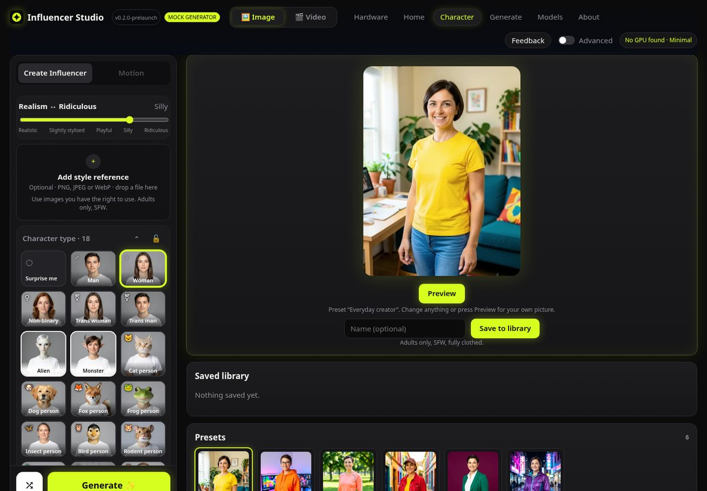
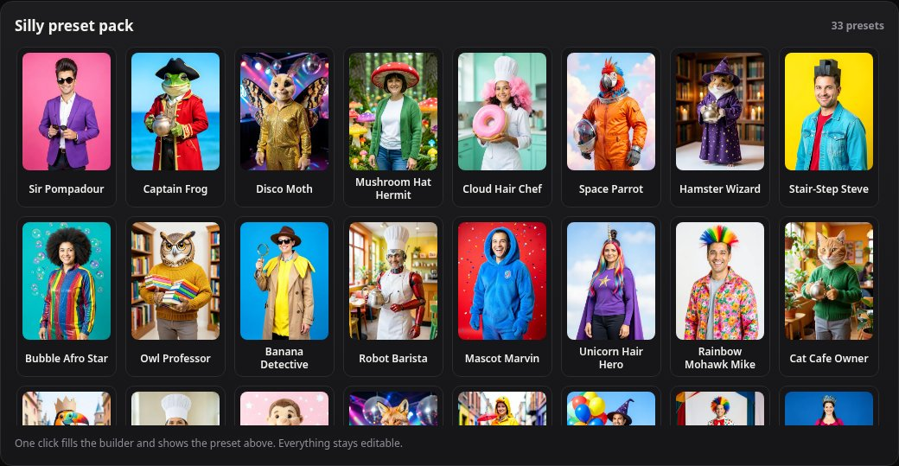
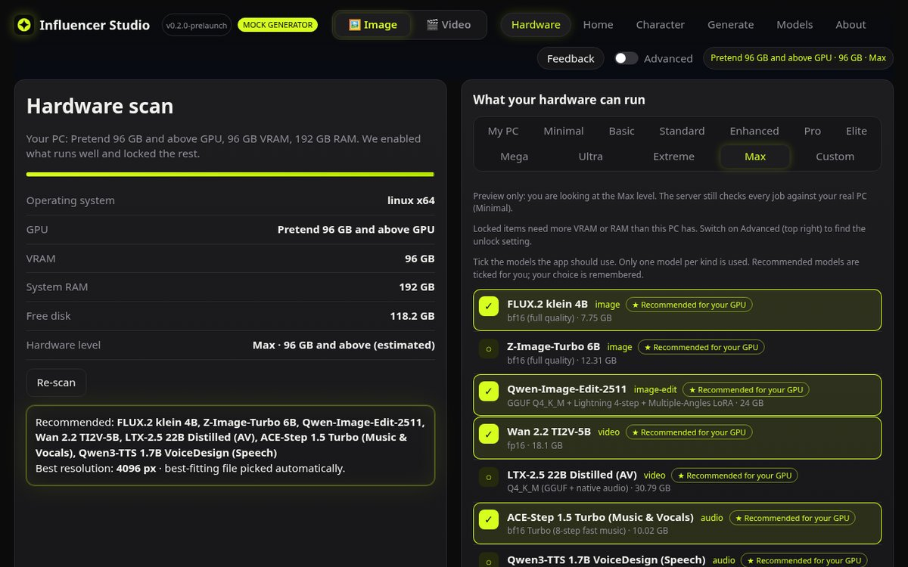
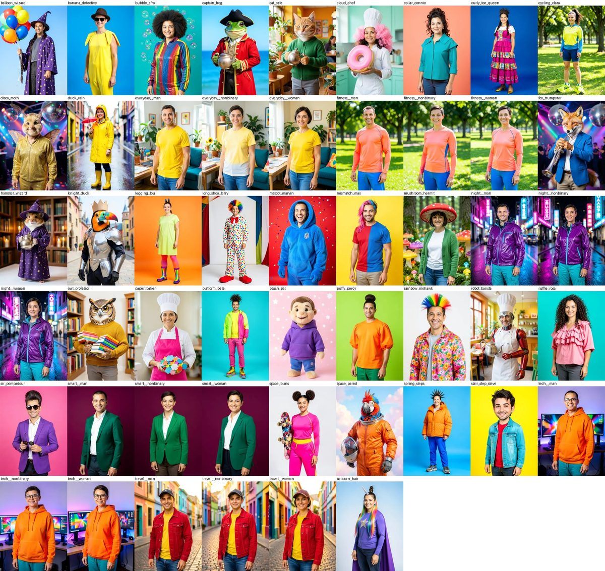

<p align="center"></p>

# Influencer Studio

**Build a character, then make photos, short videos, music and voice lines of them, on your own computer.**

Influencer Studio is a free, open-source app for making social-media style characters, from sensible everyday creators to ridiculous ones (a frog pirate, an owl professor, a disco moth). It runs on your own PC on top of [ComfyUI](https://github.com/Comfy-Org/ComfyUI), uses open-weights models only, and opens in your browser. Nothing is uploaded anywhere.

Everything it makes is **SFW: adults only (21+ in the builder), fully clothed and respectful.**

Version **0.2.0-prelaunch** (an early preview; see [CHANGELOG.md](CHANGELOG.md)). Windows is the main platform; the Linux build is experimental.

<p align="center"></p>

## Contents

- [What it does](#what-it-does)
- [Screenshots](#screenshots)
- [What you need](#what-you-need)
- [Hardware levels](#hardware-levels)
- [Quick start (Windows)](#quick-start-windows)
- [Models and licences](#models-and-licences)
- [Documentation](#documentation)
- [Run from source](#run-from-source)
- [Safety](#safety)
- [Licence](#licence)

## What it does

- **Character builder.** Pick a type (Man, Woman, Non-binary, Trans woman, Trans man, Alien, Monster, and creature types such as cat, fox, frog, bird or robot people), body size, age (21+), hair, face, outfit, shoes, accessories, props, expression, lighting, background and style. Every option has a photo thumbnail. A **Realism to Ridiculous** slider moves the look from everyday to silly.
- **Presets.** 6 everyday presets and a **Silly preset pack** of 33 characters, each with its own picture. One click fills the builder; everything stays editable. Save your own characters to a library.
- **Images.** Text to image with **FLUX.2 klein 4B** (fast, 4 steps) or **Z-Image-Turbo 6B** (crisp photoreal). Optional style reference picture.
- **Same character, new scene or angle.** Keep a saved character and change the outfit, place, pose, light or camera angle with **Qwen-Image-Edit-2511**.
- **Video.** Animate a picture with **Wan 2.2 TI2V-5B** (silent) or the optional **LTX-2.5 22B Distilled** (video with synced speech and sound effects).
- **Audio.** Background music with **ACE-Step 1.5**, spoken voice lines with **Qwen3-TTS 1.7B VoiceDesign**, and one click to put a track onto a clip.
- **Fits your PC.** A hardware scan sorts your computer into a level and locks what it cannot run, with the real numbers ("Needs 12 GB VRAM, you have 8 GB"). An Advanced setting lets you unlock soft limits at your own risk.
- **Model downloads in the app.** Shows the licence first, checks disk space, can pause and resume, and checks every file against a stored SHA-256.
- **Private by design.** Listens on `127.0.0.1` only, behind a private link with a session token. No account, no telemetry. The only internet traffic is model downloads from Hugging Face when you press Download.
- **Built on the Comfy Developer Platform.** Every job goes through the official Comfy SDK to comfy-api-proxy (Comfy API v2) on your own computer, in front of your local ComfyUI. No Comfy Cloud, Router, partner nodes or API keys.

## Screenshots

**Silly preset pack.** One click fills the builder and shows the preset in the big preview.



**Same character in new scenes** (real output from Qwen-Image-Edit-2511 on a 16 GB GPU).


**Hardware screen.** The scan, the level picker and the model list. This shot uses the test mode that pretends to have a 96 GB GPU.



**Every preset picture** (generated with FLUX.2 klein 4B from synthetic characters).



## What you need

- **Windows 10 or 11, 64-bit** (main platform). Linux x64 works but is experimental.
- **An NVIDIA graphics card** to generate. 16 GB of VRAM is the tested level; 8 GB runs FLUX.2 klein 4B images. With no GPU you can still use the builder and try the interface in mock mode.
- **ComfyUI** on the same computer, with the **ComfyUI-GGUF** custom node. Use the one you have (found on port 8188 or 8288), or let the optional installer set one up. ComfyUI is a separate GPL-3.0 program and is not included in the download.
- **comfy-api-proxy** (MIT, Comfy Org). The optional installer adds it.
- **Disk space** for the models you choose: about 16 GB for FLUX.2 klein 4B alone, about 116 GB for every model. An SSD loads models much faster than a hard disk.
- 16 GB of system RAM or more (32 GB for the edit and video models).

## Hardware levels

The app reads your GPU's VRAM and picks a level. Only the Pro level has been measured end to end; the others are estimates from file sizes and model cards.

| Level | VRAM | Largest image | What unlocks (at each model's minimum) |
|---|---|---|---|
| Minimal | no usable NVIDIA GPU | none | Builder, presets, library, About. Generation is locked. |
| Basic | under 8 GB | 768 px | ACE-Step music and voice lines from 6 GB. Image models are locked. |
| Standard | 8 GB | 1024 px | FLUX.2 klein 4B images |
| Enhanced | 12 GB | 1280 px | Z-Image-Turbo, Qwen-Image-Edit (same character), Wan 2.2 video |
| Pro (tested) | 16 GB | 1536 px | Everything above at recommended settings, plus LTX-2.5 with audio |
| Elite | 24 GB | 2048 px | Bigger images, longer clips and batches |
| Mega | 32 GB | 2560 px | |
| Ultra | 48 GB | 3072 px | |
| Extreme | 64 to 80 GB | 3584 px | |
| Max | 96 GB and above | 4096 px | |

Locked options say why when you hover them. A **Custom** level lets you enter your own numbers. See [docs/FIRST_RUN.md](docs/FIRST_RUN.md#3-check-your-hardware-level).

## Quick start (Windows)

1. Download `InfluencerStudio-0.2.0-prelaunch-win-x64.zip` from the [Releases page](https://github.com/OpenInfluencerStudio/influencer-studio/releases). You can check it against the `.sha256` file.
2. Right-click the zip, choose **Extract All**, and pick a normal folder such as `C:\InfluencerStudio`.
3. Already run ComfyUI? Start it. No ComfyUI yet? Double-click **Install ComfyUI (optional).bat** once (about a 2 GB download).
4. Double-click **start.bat**. Your browser opens on a private link ending in `#t=...`. Keep the black window open while you use the app.
5. Follow the short tour, open **Models**, and download **FLUX.2 klein 4B** first (about 16 GB). Then go to **Character**, pick a preset and press **Preview**.

Windows may warn that the app is unrecognised, because builds are not code-signed yet. Choose **More info > Run anyway** only if you downloaded it from the official Releases page.

Full steps, including Linux (experimental): [docs/INSTALL.md](docs/INSTALL.md). First steps in the app: [docs/FIRST_RUN.md](docs/FIRST_RUN.md).

## Models and licences

Model weights are not included. You download them in the app (after accepting each licence) or yourself. Each file is checked against a stored SHA-256.

| Model | Used for | Licence |
|---|---|---|
| FLUX.2 klein 4B | Images, previews, style reference | Apache-2.0 |
| Z-Image-Turbo 6B | Photoreal images | Apache-2.0 |
| Qwen-Image-Edit-2511 (GGUF) + Lightning and Multiple-Angles LoRAs | Same character, new scene or angle | Apache-2.0 |
| Wan 2.2 TI2V-5B | Silent video | Apache-2.0 |
| LTX-2.5 22B Distilled (GGUF), optional | Video with synced speech and sound | LTX-2 Community License, accepted in the app before download (free for individuals and organisations under $10M annual revenue) |
| ACE-Step 1.5 Turbo | Music | MIT |
| Qwen3-TTS 1.7B VoiceDesign | Voice lines | Apache-2.0 |

ComfyUI (GPL-3.0) and the ComfyUI-GGUF node (Apache-2.0) are separate programs that you install; the app only talks to them over their local API. The Comfy SDK and comfy-api-proxy are MIT. Full list with sources: [THIRD_PARTY.md](THIRD_PARTY.md).

## Documentation

| Document | What it covers |
|---|---|
| [docs/INSTALL.md](docs/INSTALL.md) | Installing on Windows, and on Linux (experimental) |
| [docs/FIRST_RUN.md](docs/FIRST_RUN.md) | The first run, your hardware level, and downloading models |
| [docs/TROUBLESHOOTING.md](docs/TROUBLESHOOTING.md) | Fixes for common problems |
| [FAQ.md](FAQ.md) | Short answers to common questions |
| [docs/TESTING.md](docs/TESTING.md) | A checklist for testers |
| [SAFETY.md](SAFETY.md) | What content is allowed and how the app enforces it |
| [THIRD_PARTY.md](THIRD_PARTY.md) | Every model and component, with licence and source |
| [CONTRIBUTING.md](CONTRIBUTING.md) | How to report issues and send changes |
| [CHANGELOG.md](CHANGELOG.md) | What changed in each version |
| [comfyui/README.md](comfyui/README.md) | The optional app-managed ComfyUI |

## Run from source

Needs Node.js 20 or newer.

```bash
npm install
npm run build
npm start          # prints a private link like http://127.0.0.1:8787/#t=...
```

Open the printed link. The `#t=...` part is the session token; the app will not work without it. No GPU? `INFLUENCER_STUDIO_MOCK=1 npm start` draws labelled placeholder pictures so you can try the whole interface.

Settings (environment variables):

| Variable | Default | Meaning |
|---|---|---|
| `COMFYUI_URL` | unset (auto-detect) | Your ComfyUI address. Must be on this computer. When unset, the app looks for ComfyUI on port 8188 (stock install), then 8288, then its own optional managed ComfyUI on 8190. Set it to always use one address. |
| `COMFYUI_PORTS` | `8188,8288` | Ports to auto-detect, in order (only used when `COMFYUI_URL` is unset). |
| `INFLUENCER_STUDIO_MANAGED_COMFY` | on | `0` = never start the app-managed ComfyUI (see `comfyui/README.md`). |
| `INFLUENCER_STUDIO_ENGINE` | `sdk` | `sdk`: every job goes through the **Comfy SDK** to a local **comfy-api-proxy** (Comfy API v2) in front of your ComfyUI. `direct`: the app's own ComfyUI client, a fallback for troubleshooting only. |
| `COMFY_PROXY_URL` | unset | Use a comfy-api-proxy you already run (for example `http://127.0.0.1:8189`). When unset, the app uses a running proxy on 8189 or 8289 that fronts the same ComfyUI, or starts its own on 8191. |
| `PORT` | `8787` | Local port (the server only listens on `127.0.0.1`). |
| `INFLUENCER_STUDIO_MODELS_DIR` | unset | Your ComfyUI `models` folder, so installed files are detected. |
| `INFLUENCER_STUDIO_DATA` | `.runtime/` | Where settings, the job queue, the library and outputs are stored. |
| `INFLUENCER_STUDIO_PREVIEWS` | `assets/previews/` | Folder with the generated option thumbnails (webp) and `manifest.json`. Missing files fall back to drawn previews. |
| `INFLUENCER_STUDIO_MOCK` | off | `1` = **mock generator**: draws labelled placeholder images, no AI. For trying the UI without a GPU or ComfyUI. |

Develop:

```bash
npm test               # server unit, golden and HTTP tests (vitest)
npm run typecheck
npm run dev:server     # tsx watch (set INFLUENCER_STUDIO_TOKEN to keep a fixed token)
npm run dev:ui         # vite dev server (UI only)
node scripts/package.mjs --platform win --arch x64   # build a release package
node scripts/check-links.mjs --external              # check every link in the docs
```

Layout: `server/` (Node and TypeScript), `ui/` (Preact and Vite), `workflows/` (ComfyUI API templates), `data/limits.json` (hardware levels), `models.json` (model registry with licences and checksums), `comfyui/` (optional installer). More in [CONTRIBUTING.md](CONTRIBUTING.md).

## Known limits

- Early preview: expect rough edges. Builds are not code-signed.
- The hardware scan reads NVIDIA GPUs only. AMD and Apple GPUs show as "no usable GPU" for now.
- Only the 16 GB level is measured; other levels are estimates.
- Camera angles in "Same character" are approximate: side and front-quarter views work, low angles are weak, back views come out as a side profile.
- "Very slim" and "Extra slim" body sizes look nearly alike, so those tiles carry a small silhouette badge.
- On a hard disk, same-character edits take 2.5 to 5 minutes; an SSD is much faster.
- Not built yet: motion transfer, standalone lip-sync, an automatic image safety check on outputs and references, a signed model catalogue, macOS packages.

## Safety

Adults only, fully clothed, non-demeaning, SFW. The builder has no option for minors, every prompt goes through safety rules and a blocked-terms filter, and only permissively licensed SFW models are listed. Do not use real people's likeness without their consent. The guard rails are best effort, not a guarantee; see [SAFETY.md](SAFETY.md).

## Licence

Influencer Studio is licensed under [Apache-2.0](LICENSE). Models and other components keep their own licences; see [THIRD_PARTY.md](THIRD_PARTY.md).

Feedback and bugs: [GitHub Issues](https://github.com/OpenInfluencerStudio/influencer-studio/issues). Updates: [@OpenInflStudio](https://x.com/OpenInflStudio) on X.
